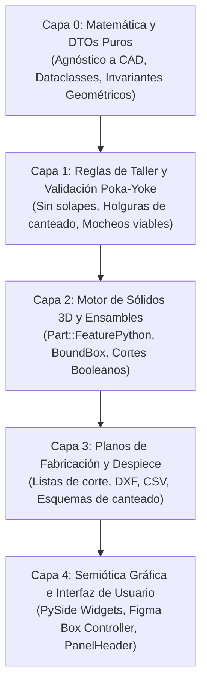

# 📐 MANIFIESTO DE DISEÑO DE INTERFAZ VDO
## Ergonomía Cognitiva, Semiótica Espacial y Poka-Yoke para CAD/CAM

> *"Si una función geométrica nueva no tiene una forma de seleccionarse, comprenderse e inspeccionarse visualmente en la pantalla con el lenguaje del carpintero y sin riesgo de colisión, la función NO está terminada."*

---

### 📌 I. La Tesis Central: Por qué fracasa la UI del CAD tradicional

El software CAD/CAM convencional comete un error ontológico fundamental: **trata al mueble como una base de datos relacional y al usuario como un digitador de formularios administrativos.**

Llenar una columna vertical con 20 campos de texto plano (*Ancho Frente, Offset Izquierda, Encuentro Esquinas, etc.*) sobrecarga la memoria de trabajo del diseñador, exige una traducción mental abstracta y agotadora entre una tupla de números y un sólido volumétrico, y permite combinaciones físicamente imposibles que colapsan el motor geométrico.

En el **Sistema VDO**, la interfaz no es un formulario: **es un modelo semiótico directo de la materia prima, de la física del tablero y del oficio del taller de carpintería industrial.**

```text
       ENFOQUE TRADICIONAL (Roto)                     ENFOQUE VDO (Semiótico)
┌───────────────────────────────────────┐     ┌───────────────────────────────────────┐
│ [Label] Input: 70.0                   │     │               ▲ FONDO                 │
│ [Label] Input: 18.0                   │     │            ┌─────┬─────┐              │
│ [Combo] Select: Vertical domina...    │ ──► │     IZQ    │  🔗 │ DER │   (El widget │
│ (Desconectado de la forma;            │     │            └─────┴─────┘     ES el    │
│  permite ingresar colisiones físicas) │     │               ▼ FRENTE      tablero)  │
└───────────────────────────────────────┘     └───────────────────────────────────────┘
```

---

### 🏛️ II. Los 7 Pilares de la Interfaz VDO

#### Pilar 1: Semiótica Espacial Directa (El Widget es el Tablero)
* **Axioma:** *Ninguna relación espacial debe expresarse con palabras si puede expresarse con topología.*
* Si un tablero físico tiene 4 bordes y 4 esquinas, el control gobernante debe ser una matriz gráfica interactiva 3 × 3:
  * Los **centros de arista** gobiernan las tiras físicas de melamina (`▲ FONDO`, `▼ FRENTE`, `◄ IZQ`, `DER ►`).
  * Los **vértices** gobiernan los nodos de encuentro físico entre tiras adyacentes (`NO`, `NE`, `SO`, `SE`).
  * El **núcleo** gobierna la superficie del tablero, la uniformidad dimensional y el bloqueo maestro (`[🔗]`).
* **Proyección Isomórfica:** El diseñador interactúa por correspondencia espacial directa:
  * Tocar el botón superior modifica el borde posterior de la madera.
  * Tocar una esquina conmuta cíclicamente el tipo de corte (a tope, inglete, marco interior).
  * No hay intermediación semántica ni ambigüedad izquierda/derecha.

#### Pilar 2: Dualidad Ontológica (Vano vs. Estructura)
Un carpintero y un proyectista alternan constantemente entre dos modelos mentales mutuamente excluyentes:
1. **Modo Espacio (Vanos / Vacíos):** Piensa en volúmenes útiles libres para almacenar cosas (*"Quiero meter un cajón en este hueco"*, *"Quiero dividir esta luz en 3 partes iguales"*).
2. **Modo Sólido (Estructura / Madera):** Piensa en piezas físicas para cortar, cantear y mecanizar (*"Este techo lleva regrueso de 70 mm"*, *"Este lateral es de 18 mm"*).

* **Regla de Oro VDO:** *Prohibido mezclar vanos y piezas en la misma vista o inspector.*
* La interfaz implementa un conmutador de modo explícito:
  * **Modo Vanos (`🔲`):** El árbol y el visor 2D solo representan cavidades libres. El inspector reporta **Luz Libre Nominal** (eje) vs. **Luz Neta Real** (descontando tiras invasoras) y expone herramientas de subdivisión fractal. La sección de regrueso no existe aquí.
  * **Modo Estructura (`🪵`):** El árbol clasifica por familias físicas puras (Horizontales, Verticales, Divisiones). El inspector reporta cotas brutas de corte, canteado y expone los modificadores perimetrales (Box Model).

#### Pilar 3: El Carné de Identidad Universal (`PanelHeaderWidget`)
* **Axioma de Equivalencia Física:** *En una seccionadora industrial no existen "puertas", "zócalos" ni "repisas". Solo existen rectángulos de melamina con 4 cantos.*
* En cualquier ventana, diálogo o inspector del ecosistema VDO, al seleccionar cualquier entidad física (lateral de COCO, tira de zócalo, puerta batiente, repisa o tira de regrueso), la cabecera **DEBE** mostrar el mismo micropanel inmutable:

```text
┌────────────────────────────────────────────────────────────────────────┐
│  [ Nombre de Pieza ]   [ Largo × Ancho × Espesor mm ]                  │
│  [ Cantos:  N: FX | S: RIG (2mm) | E: FX | O: SMRG ]                   │
└────────────────────────────────────────────────────────────────────────┘
```
* Esto actúa como un ancla cognitiva constante: el operario y el diseñador siempre saben qué pieza física de la lista de corte tienen entre manos.

#### Pilar 4: Poka-Yoke Radical (La Interfaz como Seguro Físico)
* **Axioma:** *La interfaz debe hacer que el error geométrico sea física y lógicamente imposible de formular.*
* Si dos opciones de configuración producen un volumen de colisión mayor a cero ($V_{\text{colisión}} > 0$) o una fractura física de la madera, la UI **no debe permitir seleccionarlas juntas**:
  * **Eliminación de la ambigüedad en L:** Se prohíbe que cada lado decida si es "pasante o tope" de forma aislada. La dominancia se decide en el nodo de la esquina (Tope lateral, Tope frontal, Inglete 45°, Marco interior). La esquina manda sobre las tiras concurrentes.
  * **Sincronización Bidireccional Master:** Controles maestros como `[ All ]` o `[🔗 Sincronizar esquinas]` reflejan el estado real: si el usuario desmarca un solo borde a mano, `[ All ]` se desmarca automáticamente; si enciende los cuatro, se marca solo.
  * **Feedback Táctil con Iluminación de Acento:** Todo botón conmutable debe aplicar `:checked` con iluminación en azul acento (`#007acc`), borde nítido (`#0098ff`) y texto contrastado (`#ffffff`). Los botones mudos o planos son defectos de diseño inaceptables.

#### Pilar 5: Neutralidad y Rigor en el Lenguaje de Taller
* **Axioma:** *El vocabulario debe pertenecer al operario de banco y al seccionador, no a la academia de arquitectura.*
* Se erradican términos arquitectónicos oscuros, regionalismos ambiguos y anglicismos innecesarios:
  * ❌ *Retranqueo* $\longrightarrow$ ✔️ **Separación del canto** (o *Distancia al borde*).
  * ❌ *Calle libre* $\longrightarrow$ ✔️ **Luz perimetral** (o *Borde libre*).
  * ❌ *Confinado* $\longrightarrow$ ✔️ **Marco interior**.
  * ❌ *Pasante* $\longrightarrow$ ✔️ **De punta a punta** (o *Dominante*).
  * ❌ *Mocheo crudo* $\longrightarrow$ ✔️ **Rebaje / Cajeado en escuadra**.

#### Pilar 6: Resiliencia Gráfica y Ergonomía de Alto Contraste
* **Iconografía Vectorial Autocontenida (Lucide / Tabler):**
  * Prohibido enlazar archivos `.png` o `.svg` en disco que puedan fallar en entornos sandboxed (Flatpak, Snap, AppImage o Windows).
  * Todos los iconos se definen como constantes SVG puras dentro del código Python y se renderizan en memoria vía `QtSvg.QSvgRenderer`.
* **Ergonomía Dark Mode Estricta:**
  * FreeCAD opera nativamente en entornos oscuros. Forzar `background: #ffffff` sin fijar `color: #000000` causa textos invisibles.
  * Toda la UI VDO sigue una jerarquía cromática estricta de luminancia:
    * **Superficie base:** `#141414` / `#1e1e1e`.
    * **Superficie interactiva:** `#252525` / `#2b2b2b`.
    * **Bordes estructurales:** `#3a3a3a` / `#444444`.
    * **Acentos activos:** Azul `#007acc` / `#0098ff`.
    * **Tipografía primaria:** `#e0e0e0` / `#ffffff`.
    * **Tipografía secundaria y cotas:** `#888888`.

#### Pilar 7: Entrada Numérica Agnóstica e Inmune al Locale
* **Axioma:** *Un diseñador no debe luchar contra el teclado numérico de su sistema operativo.*
* `VDO_DoubleSpinBox` como estándar obligatorio:
  * Acepta indistintamente coma (`,`) o punto (`.`) decimal, independientemente del locale configurado en el sistema operativo (es_ES, en_US, de_DE).
  * Permite fijar cotas de precisión milimétrica sin truncamiento accidental ni excepciones de parseo numérico en tiempo de ejecución.

---

### 📋 III. Especificación de Primitivas de UI del Sistema

| Primitiva UI VDO | Metáfora Semiótica | Comportamiento Interactivo | Ámbito de Aplicación en el Ecosistema |
| :--- | :--- | :--- | :--- |
| **`VDOBoxControllerWidget`** | Cuadrado 3 × 3 del Tablero *(Figma Box Model)* | Clic en bordes enciende/apaga tiras; clic en esquinas cicla uniones (tope/inglete/marco); candado central conmuta uniforme vs. individual; selector de lado para calibración independiente. | Reengroses de carcasa, Zócalos de piso, Canteado perimetral, Fajas de dilatación a muro. |
| **`PanelHeaderWidget`** | Etiqueta de Código de Barras de Taller | Solo lectura interactiva. Muestra dimensiones nominales netas y el estado de los 4 cantos con códigos de taller (`FX`, `RIG`, `SMRG`). | Cabecera superior de todos los inspectores de piezas físicas (COCO, Paneles, Cajones, Puertas). |
| **`VanoInspectorWidget`** | Calibrador de Luz Libre | Muestra dos columnas: **Cota Nominal** (eje de mueble) vs. **Cota Útil Neta** (restando invasores estructurales). Casilla de subdivisión fractal de vano. | Pestaña "Vanos" del COCO al tocar cualquier hueco vacío en el árbol o en el visor 2D. |
| **`HardwareSelectorWidget`** | Mostrador de Ferretería Industrial | Dropdown de marcas comerciales reales (Ducasse, Blum, Hettich, genéricas). Computa cotas CAD automáticas ($D_1, D_2$, Newtons, taladros) y costo en tiempo real. | TaskPanels de Puertas (Batientes / Corredizas / Flap) y Cajones (Tandem / Ocultas / Telescópicas). |

---

### 🔄 IV. La Rebanada Vertical Completa (Full Vertical Slice)

Toda feature desarrollada en el Sistema VDO debe construirse respetando las 5 capas de la arquitectura:



---

### ⚖️ V. La Regla de Oro para Desarrolladores y Agentes

> **"Si una función geométrica nueva no tiene una forma de seleccionarse, comprenderse e inspeccionarse visualmente en la pantalla con el lenguaje del carpintero y sin riesgo de colisión, la función NO está terminada."**

Ningún pull request, refactor o nueva macro se considerará cerrado si:
1. Obliga al usuario a escribir números de cota en campos de texto aislados sin representación topológica.
2. Permite que el usuario configure piezas con volumen de colisión positivo ($V_{\text{solape}} > 0$).
3. Mezcla en una misma lista los vacíos del mueble (vanos) con las maderas que lo componen (estructura).
4. Depende de rutas locales en disco para cargar iconos o recursos gráficos.
5. Falla al procesar comas decimales en teclados hispanos o europeos.
